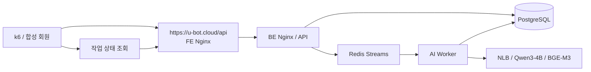

# 채팅 E2E 시험

| 실행 | 결과 |
|---|---|
| 2026-10-22~23 로컬 | [Worker 동시성 4·16·32·64·128과 클라우드 파일럿](results/20261023-local/chat-burst/results) |
| 2026-10-25 AWS 반복 질문 | [3,000명 반복 질문·답변 품질 검토](results/20261025-aws-repeated) |
| 2026-10-25 AWS 다양한 질문 | [1·2차 원본 집계](results/20261025-aws-diverse) |
| 2026-10-26 AWS 재시험 | [최종 결과·실패 원인·설정 반영](results/20261026-aws/README.md) |

## 요청 경로



HTTP 202는 작업 접수입니다. 답변 완료는 `/chat/jobs/{jobId}`와 DB 최종 상태를 별도로 확인합니다. 3,000명의 전송 시작 시각을 맞췄으며, 로그인·TCP/TLS 준비는 전송 전에 수행했습니다.

## 재실행

Node.js 24, k6 2.2.0과 별도 시험 환경이 필요합니다. `prepare`는 지정한 수만큼 실제 시험 회원을 생성합니다. 실행마다 새로운 run-id와 결과 폴더를 사용합니다.

```powershell
node chat-e2e/tools/k6/cli.mjs prepare --dir .local/new-run-a --run-id new-run-a --base-url https://u-bot.cloud/api --questions chat-e2e/datasets/20261026/run-1-questions.json --total 3000 --concurrency 4
node chat-e2e/tools/k6/cli.mjs run --dir .local/new-run-a --start-delay-seconds 60 --warm-connections true --http-timeout-seconds 300
node chat-e2e/tools/k6/cli.mjs collect --dir .local/new-run-a --rps 20 --max-wait-seconds 3600
python chat-e2e/tools/analyze_run.py .local/new-run-a
```

2차는 `run-2-questions.json`과 다른 run-id로 같은 절차를 실행합니다. 최종 1차의 요청 시작 범위는 62ms, 2차는 42ms였습니다. 시작 정렬만 맞춘 결과이며 실제 서버 동시 실행 수를 3,000으로 주장하지 않습니다.

`credentials.private.json`에는 비밀번호·토큰이 있으므로 결과 공개 목록에 넣지 않습니다. `analysis-rows.json`에는 질문·실제 답변·오류를 기록합니다. [SQL 감사 도구](tools/build_db_audit.py)는 이 답변과 저장된 답변의 해시를 비교할 읽기 전용 SQL을 만듭니다.

## 질문셋

[20261026 질문셋](datasets/20261026)은 77개 카테고리·1,498개 FAQ에서 만든 서로 다른 질문 6,000개입니다. FAQ 원문·색인 표현과 정규화한 문자열이 같은 질문, 양 실행 사이 중복, 개인 이용 정보 조회 질문을 제외했습니다. 각 회차는 일반 변형 2,700개와 경쟁 FAQ 표현이 겹치는 후보 300개로 구성했습니다.

`boundary`는 어휘 중복을 기준으로 만든 애매한 질문 후보입니다. 실제 임베딩 점수가 임계값 근처라는 뜻은 아닙니다. 일반적인 머리말을 붙인 질문도 포함되며, 이 머리말이 별도 하위 질문으로 분리되는 사례는 품질 검토 대상으로 남겼습니다. 질문별 원본 FAQ·기대 근거는 `manifest.json`에 있습니다.

`build_dataset.py`는 함께 보관한 FAQ seed·활성 목록·답변 보정 정보를 기본 입력으로 사용합니다. `UBOT_DATASET_OUTPUT`으로 출력 폴더, `UBOT_FAQ_SEED`로 새 seed 경로를 지정할 수 있습니다. 원본 생성기도 `provenance/originals`에 보관했습니다. 새 FAQ로 시험할 때는 seed뿐 아니라 활성 목록·답변 보정 정보도 갱신해야 합니다.
