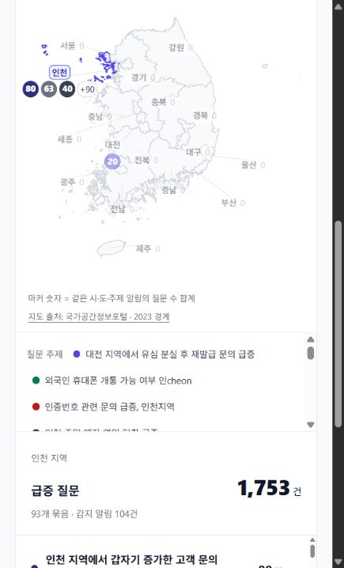
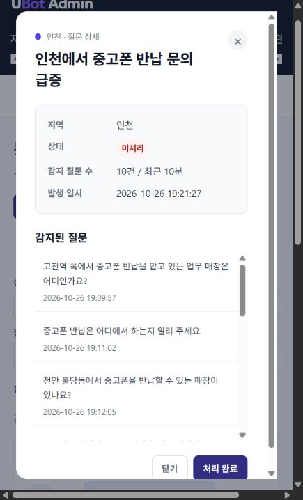

# 통신지도 검증

2026-10-26 실제 `u-bot.cloud` FE에서 임시 관리자 계정으로 로그인해 지도·목록 전환, 인천 지역 필터, 급증 알림 상세를 확인했습니다. 같은 결과를 관리자 API와 State DB의 읽기 전용 SQL로 대조했습니다.

| 확인 항목 | 결과 |
|---|---|
| 전국 알림 / 질문 / 지역·주제 묶음 | 105 / 1,773 / 94 |
| 인천 필터 | 알림 104, 질문 1,753 |
| 대전 | 알림 1, 질문 20 |
| 기존 알림 #41 | 로밍 문의 20건, 상세 스냅샷 20개, 모두 합성 시험 회원 |
| 오늘 알림 #105 | 중고폰 반납 문의 10건, 상세 스냅샷 10개 |
| 최종 부하 시험의 하위 질문 로그 | 6,904건 |
| 지도 등록 / 클러스터 | 6,474건 / 557개 |
| 지역 불일치 / 중복 question_log 연결 | 0 / 0 |
| 익명 조회 / size=101 | HTTP 401 / 400 |

지역은 접속 IP로 판정합니다. 질문에 적힌 매장 위치나 회원 가입 시 입력한 거주지를 지도 지역으로 사용한 결과가 아닙니다. 발생기가 한 AWS 위치에서 요청했으므로 최종 시험의 하위 질문 로그 지역은 모두 인천입니다. 실제 사용자 IP는 결과에 저장하지 않았습니다.

실행 이미지 안의 설정도 직접 읽었습니다. 감지 구간 10분, 건수 기준 10, 클러스터 유사도 0.7, 최소 보존 1,440분이었습니다. 기존 알림 #41의 20건을 현재 건수 임계값으로 추정하지 않았습니다. 알림은 감지 당시 스냅샷이며, 같은 클러스터·사용자의 짧은 간격 반복 질문은 중복 집계하지 않으므로 전체 하위 질문 수와 지도 등록 수가 다를 수 있습니다.

[API 대조](results/20261026/api-verification.json) · [오늘 알림 API](results/20261026/current-alert-api-verification.json) · [DB 대조](results/20261026/database-audit.json) · [실행 설정](results/20261026/runtime-settings.txt)

## 화면

지도 마커와 인천 질문 집계:



오늘 생성된 급증 알림 상세:



## 도구

`tools/verify.mjs`는 목록 페이지를 끝까지 읽고 지역 필터·상세 건수·중복 ID·인증·페이지 크기 제한을 검사합니다. `tools/audit.sql`은 최종 부하 시험 회원의 로그와 지도 등록 행을 대조합니다.

```powershell
node telemap/tools/verify.mjs .local/admin.private.json .local/telemap-check.json 105
```

인증 파일 형식은 `baseUrl`, `email`, `password`입니다. 계정 생성 도구는 일반 회원만 만들며 관리자 권한은 자동 부여하지 않습니다. 이번 검증 계정은 확인 후 로그아웃하고 관리자 권한 회수·계정 소프트 삭제·갱신 토큰 제거를 수행했습니다.

알림 처리 완료나 운영 데이터 수정은 시험하지 않았습니다. 이후 develop에 추가된 새로고침 API·알림 갱신 동작도 이 기록의 검증 범위에 포함하지 않습니다.
