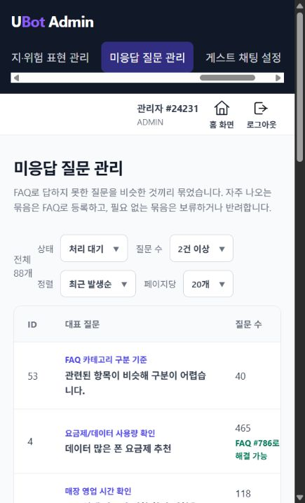
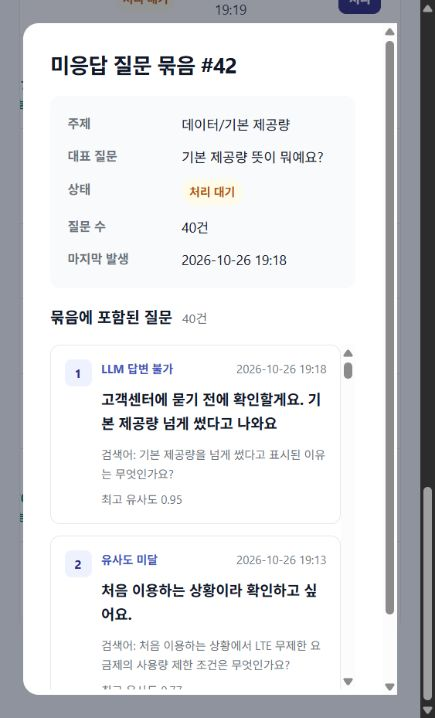

# 미응답 질문 클러스터링 검증

최종 AWS 질문 6,000건에서 생성된 미응답 하위 질문을 DB에서 추적하고, 실제 관리자 FE 목록·상세와 API 응답을 확인했습니다. 통신지도와는 별도 기능·별도 결과 폴더입니다.

| 확인 항목 | 결과 |
|---|---:|
| 최종 실행 회원의 미응답 하위 질문 | 1,165 |
| 해당 질문이 속한 묶음 | 87 |
| 동일 attempt_id·sub_question_index 중복 | 0 |
| 묶음 question_count와 실제 질문 수 불일치 | 0 |
| 사유 INSUFFICIENT_FAQ / LLM_ABSTAIN / LLM_CONFLICT | 988 / 176 / 1 |
| 관리자 목록의 대기·2건 이상 묶음 전체 | 88 |
| 상세 확인한 묶음 #42 | 40건, 원문·검색어·유사도·사유 표시 |
| 익명 조회 / minCount=0 | HTTP 401 / 400 |

87개는 최종 두 실행 회원의 질문이 들어간 묶음 수입니다. 관리자 목록의 88개에는 이전 시험 데이터도 포함됩니다. 미응답 하위 질문 수는 최종 실패 작업 수와 다릅니다. 여러 질문 중 일부만 답했거나 일반 보류 답변을 저장한 성공 작업에서도 미응답이 등록될 수 있습니다.

[DB 대조](results/20261026/database-audit.json) · [API 상세·원문](results/20261026/api-verification.json)

## 확인한 품질 문제

집계와 화면 조회는 일치했지만 묶음의 의미 정확도를 전체 통과로 판정하지 않았습니다. #42의 제목은 ‘데이터/기본 제공량’인데 개인정보 보안 조치·일반 유심 조건 등 주제가 넓은 검색어도 섞여 있었습니다. 이 묶음 40건 중 원문 조각 `question`이 빈 항목이 8건 있었고 `searchQuery`는 모두 존재했습니다. FE에서도 빈 원문 제목과 검색어가 확인됐습니다.

여러 문장으로 변형한 질문의 일반적인 머리말이 별도 검색어로 다시 작성되는 사례도 있습니다. 질문 분리와 묶음 유사도 기준을 후속으로 검토해야 합니다. FAQ 등록·반려·보류나 재검증 실행은 운영 데이터를 바꾸므로 이번 조회 검증에서 수행하지 않았습니다.

## 화면





## 도구

```powershell
node unanswered-clustering/tools/verify.mjs .local/admin.private.json .local/unanswered-check.json 42
```

관리자 인증 파일은 로컬에만 두며 `baseUrl`, `email`, `password`를 사용합니다. 공개한 #42의 질문 40건은 DB에서 모두 합성 시험 계정의 질문임을 확인했습니다. `tools/audit.sql`은 회원 이메일 접두사를 정확히 지정한 읽기 전용 조회입니다.
